+++
title = "Sparse Attention"
slug = "sparse-attention"
date = 2026-09-09
draft = false
description = "Why we need sparse attention, and how it differs from dense attention."
subtitle = "Why we need sparse attention, and how it differs from dense attention."
ogImage = "/social/og_preview_1200x630.jpg"
toc = true
+++

## Chapter 1 — Why we need sparse attention

First, I’ll cover different types of sparse attention. Then, we’ll turn an optimized dense kernel into a block-sparse one. For now, we’ll assume the selected block IDs are already given. Later, we’ll try different indexers to choose these blocks and see how they affect performance. Finally, we’ll explore a KV-centric kernel, where each query can have its own block list.

A fast dense attention kernel can make very efficient use of the GPU. But there is something that kernel optimizations alone do not change: how many query–key pairs attention needs to process.
Dense attention generally iterates through every query–key pair. The amount of work grows with the product of the query and key sequence lengths: doubling both lengths means processing four times as many pairs. Kernel optimizations make this computation more efficient, but the amount of work stays the same.

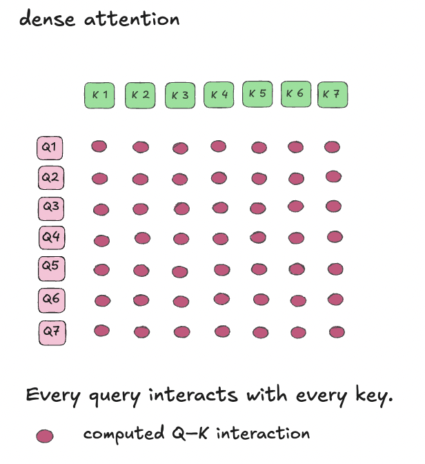

So here comes sparse attention. The main difference from dense attention is how many query–key pairs we compute: instead of every pair, each query attends only to a subset of keys. We skip the other connections, reducing the work performed by both the QK and PV matrix multiplications. The impottant thing is not only to skip computation, but challenge is deciding which connections to keep without losing too much accuracy.

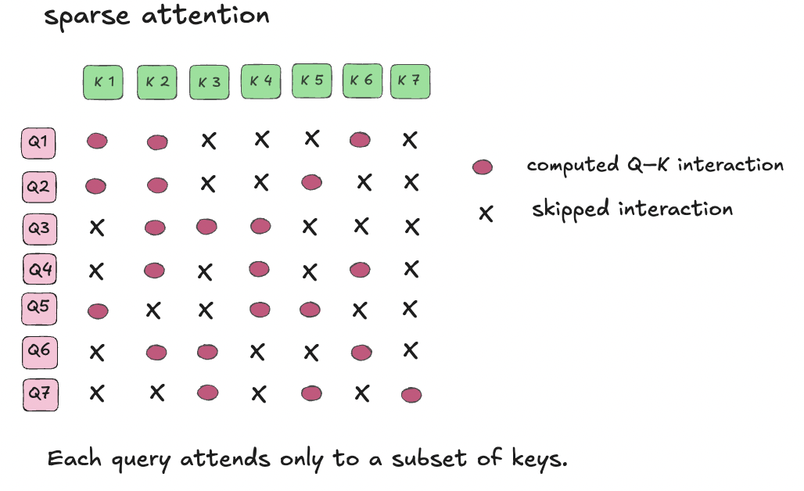

With sparse attention we can select individual K/V tokens or whole blocks of consecutive tokens. 

Block-level selection: whole groups of consecutive key/value tokens. 

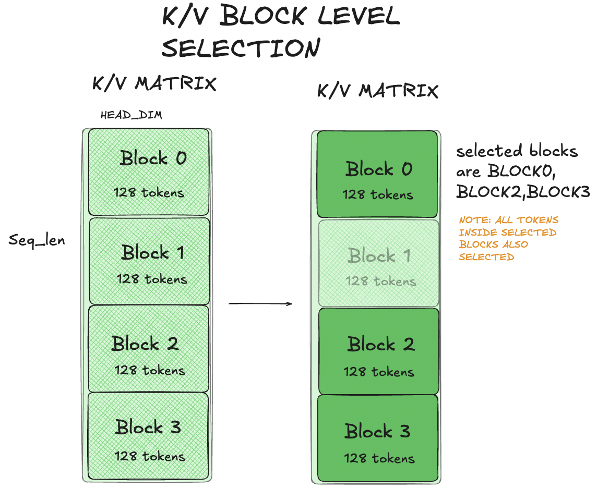

Token-level selection: individual key/value tokens.

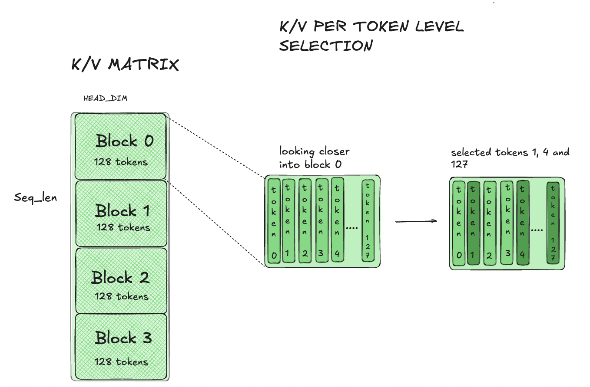

In the diagram below, each query can attend to its own list of key blocks, or several queries can share one list of key blocks.

Per-query selection. Each query has its own selected K/V block list, so even neighboring queries can choose different K/V blocks. This allows more independent choices, but it is harder to compute efficiently.

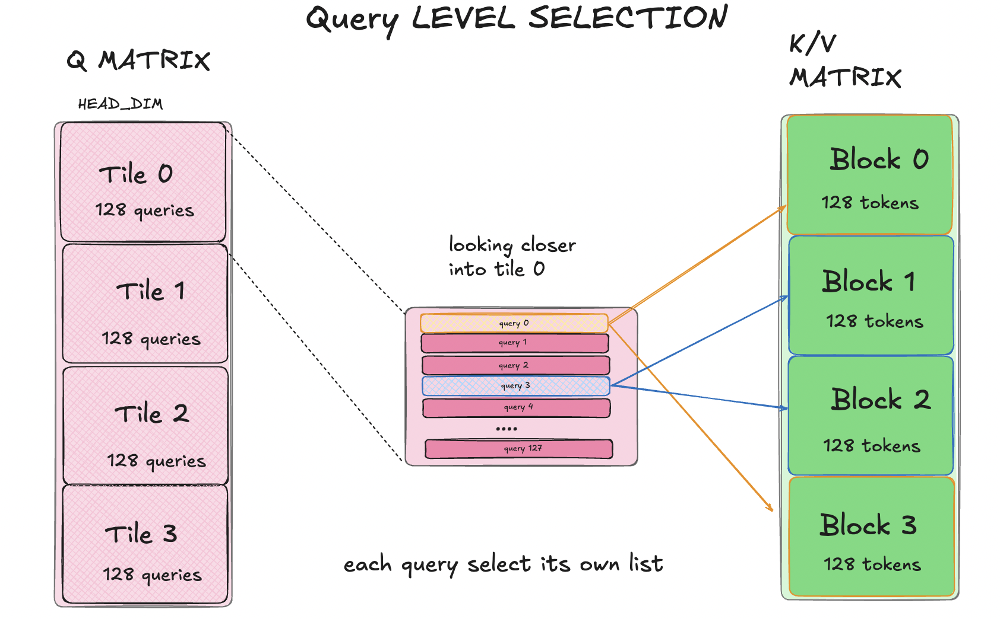

Per-Q-tile selection. All 128 queries in a Q tile share one selected KV block list, while neighboring Q tiles may have different lists. Each query still computes its own scores and softmax. Within each Q tile, the shared K list lets us reuse each selected K/V block across all 128 queries and compute a full 128 × 128 score tile.

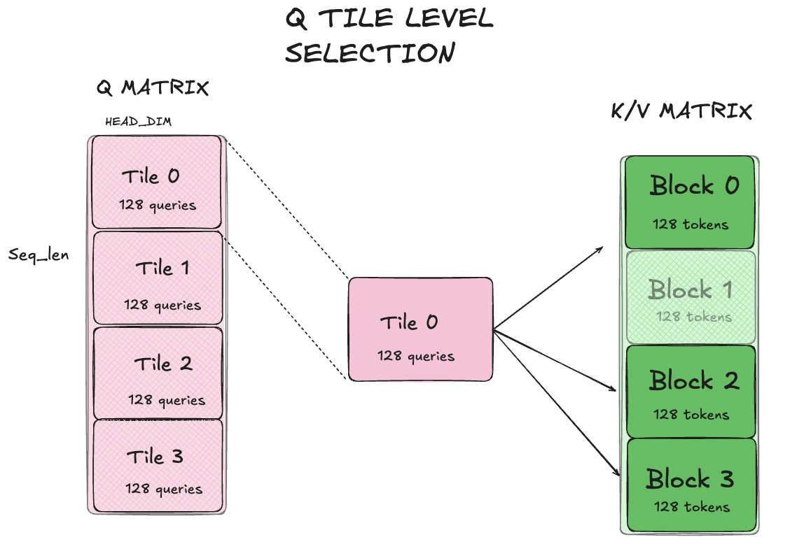

So in total, there are four combinations:

|                                 | KV blocks                                                   | Individual KV tokens                    |
|---------------------------------|-------------------------------------------------------------|-----------------------------------------|
| **Each query has its own list** | my KV-centric kernel (Chapter 5), MiniMax MSA, NSA, MoBA    | DeepSeek DSA                            |
| **One list per Q tile**         | my Q-centric kernel (Chapters 2–4), FA4 block-sparse        | rare, e.g. MInference "vertical lines"  |

My main kernel sits in the bottom-left cell of this table. Each Q tile selects it’s own set of K/V blocks: once a K/V block is selected, the kernel processes all of its 128 tokens, while different Q tiles can have different independent lists. So every selected pair of a Q tile and a KV block produces a full 128 × 128 score tile. In short, the sparsity is between blocks, not inside them.

For each query, the softmax is normalized over the keys in all its selected blocks, not separately within each block. Unselected keys receive zero attention weight. This generally changes the output compared with dense attention, so choosing useful blocks matters.

Selecting the mask and scheduling its computation are separate decisions.

This post focuses on BF16, non-causal forward attention on NVIDIA B200, with head dimension 128 and blocks of 128 tokens. The goal is to study kernel implementation and performance, not to establish that a particular sparse mask preserves model quality.

## Chapter 2 - From dense to sparse 

As the dense baseline code i took kernel 14 from [Iaroslav Elistratov’s B200 attention kernel series](https://iaroslavelistratov.github.io/b200-attention/). This is already an optimized dense kernel. It includes a number of dense kernel optimizations: warp specialization, shared-memory swizzling, Tensor Memory, load and compute pipelines, Cache96, early PV, lazy rescaling and persistent CTAs. A persistent CTA processes two neighboring Q128 tiles from one query head, completes their outputs, and then moves on to another assigned pair of Q tiles. I keep all these optimizations.

There are two logical levels of iteration: the outer persistent loop moves between pairs of Q tiles, while the inner loop visits their K/V blocks. I keep the persistent work loop and change the K/V loop from all blocks to selected blocks. I keep the attention computation the same, but changing the way of loading KV blocks, basicly we load only selected K/V tiles instead of all of them.

Lets look in pseudocode how loop for one Q tile changes:  

```cpp
  //Dense: visit every KV block.
  for (int kv_tile = 0; kv_tile < kv_tiles; ++kv_tile) {
      // Load K/V, compute QK, update online softmax, accumulate PV.
  }
```
```cpp
 // Sparse: visit the blocks selected for this Q tile.
  for (int slot = 0; slot < selected_count; ++slot) {
      const int kv_tile = selected_indices[selected_base + slot];
      const bool first_selected_tile = (slot == 0);
      // Perform the same computation for this selected block.
      //
      // Same QK, online-softmax, and PV operations
  }
```

As result we have a for loop which iterates through the selected K/V tiles.

Looking closer we add two new argumentst to our kernel:

1) selected_indices - is telling which kv we should take
2) selected_count - how many kv tiles we should iterate through. Each iteration performs the familiar operations: load K/V, compute scores, update the online softmax, and accumulate the output O.

For example, the selected_indices = [2, 5, 8] means: process KV2, then KV5, then KV8. Here, selected_count is three.

And inside the kernel, we compute selected_base to point to the beginning of the list for the Q tile.

In the dense kernel I linked, both Q tiles visit the same K/V sequence, so a loaded K/V block can be used by both of them. 

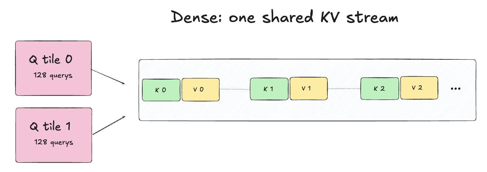

With independent sparse lists, that might not work as needed: Q0 might need KV block 2 while Q1 needs KV block 7. 
So now each Q tile has its own independent K/V stream. But each 2 Q tiles still use the same three-slot shared memory ring, every loaded block now belongs to a particular Q stream. A slot can be overwritten only after that stream has finished reading it: K after QK, and V after PV.

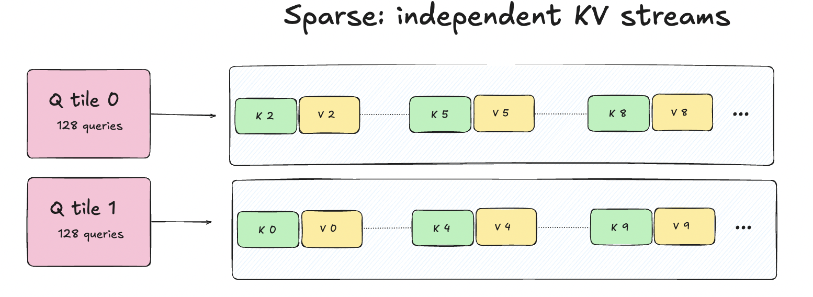

These changes transform the dense kernel into a block-sparse one.

### Grouped-query attention: sharing K and V (optional)

So far, we have focused on selecting and processing blocks within one query head. This is already a complete block-sparse attention kernel. But there is another  opportunity for data reuse: several query heads can share the same keys and values. This is called grouped-query attention (GQA). GQA specifies which query heads share K/V. It does not specify which KV blocks those heads attend to.

In standard multi-head attention, each query head has its own key and value heads. GQA allows several query heads to share one key head and one value head.

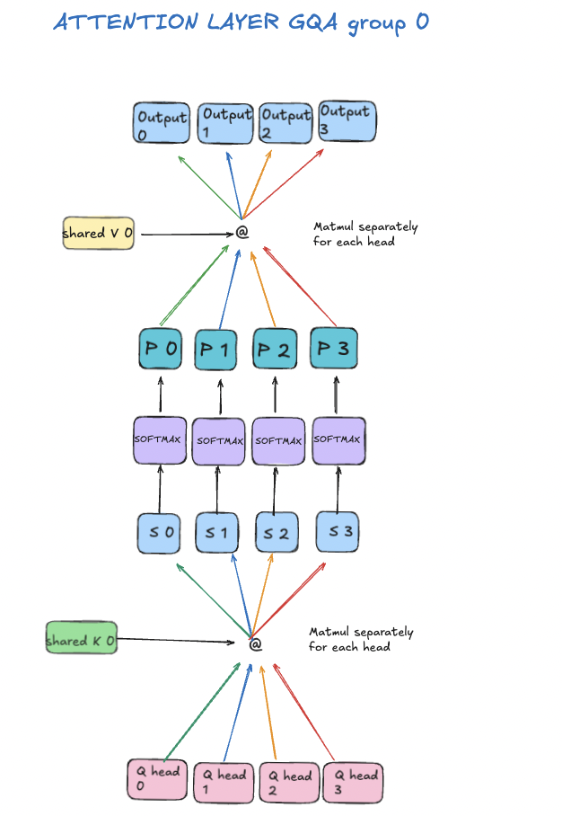

For example here each group contains four query heads. They read the same K/V tensors, but each head has its own query vectors. Sharing K/V does not mean sharing attention weights. Different queries produce different scores, so each head still computes its own softmax and output.

Our sparse attention adds one more rule: heads in the same GQA group share the selected block list for a given Q128 tile. This is our design choice, not a requirement of GQA.

Previously, one CTA task processed two neighboring Q128 tiles from the same query head. With GQA, it instead processes the same 128 positions from two different query heads that share K/V and the selected block list. Each selected K/V block is loaded once for the pair, while each head computes its own scores, softmax, and output. A group of four heads therefore requires two head-pair tasks, each with its own K/V loads. I choose pairs because Tensor Memory has 512 columns, and two heads (scores and output, 128 columns each) already fill it.

I still use the selected lists as inputs, i will return to the quetion of where these indicies come from shortly.

## Chapter 3 - Benchmarking the sparse attention kernel

We now have a block-sparse attention kernel that processes selected K/V blocks and reuses K/V across pairs of query heads. I compare my kernel with FA4 sparse on B200 using identical Q/K/V and selected blocks. At this stage, the selected block lists are already available. The benchmark measures attention execution only, without an indexer.
The benchmark uses an NVIDIA B200, BF16, D128, batch size 2, and 16 query heads sharing one KV head. Query length stays fixed at 4,096, while KV length varies. Each Q128 tile selects 16 blocks of 128 tokens.

I test two patterns: independent lists for neighboring Q128 tiles, and identical lists within each neighboring pair.

I test four FA4 sparse configurations: q_stage=1 and q_stage=2, each with PackGQA enabled and disabled. q_stage=1 and q_stage=2 use one-Q-tile and two-Q-tile schedules, respectively. For each workload, I report the best configuration among these four, rather than relying only on the default configuration.

Useful TFLOP/s counts only the floating-point operations in the selected QK and PV matrix multiplications, divided by the measured attention execution time. Softmax and other supporting operations contribute to the execution time but are not counted in the FLOP total. Higher throughput means faster execution of the same selected attention work.

At K/V length 16K:

| Neighboring Q128 lists | Our kernel, useful TFLOP/s | FA4 sparse, useful TFLOP/s | Faster implementation |
| :--- | ---: | ---: | :--- |
| Independent | 979.8 | 859.2 | Ours, 1.14× |
| Identical within each pair | 990.5 | 1111.5 | FA4, 1.12× |

With independent lists, our kernel is approximately 1.14× faster. With identical lists, FA4 is approximately 1.12× faster.
The same pattern holds at KV lengths 4K and 8K. The faster schedule depends on the structure of the sparse mask.

Our kernel reuses K/V between two query heads. FA4 q_stage=2 can benefit from matching lists between neighboring Q tiles, while q_stage=1 performs better on the independent-list cases.

Selecting the same number of blocks does not guarantee the same performance. The structure of the mask matters.

So far, the selected IDs were given. Next, i will show how to generate them and how this affects performance.

## Chapter 4 — Exploring Simple Block Selectors

Now we know how to process selected blocks efficiently, but we don’t know yet how to choose them. 
Choosing blocks is the job of an indexer, or block selector. Indexer scores which KV blocks are worth keeping and returns their IDs to the attention kernell. Indexer does not compute the final attention output.

I explore two simple experimental selectors, R1 and R4, and an FP4 scoring path adapted from MiniMax MSA. Each selector chooses 16 KV blocks for each 128-query tile and GQA group.

### R1: One Representative 

First indexer is R1, which summarizes each block with a single average vector. For each query head, R1 averages the 128 query vectors into one representative vector (representatives and index vectors are used only for selection, the attention kernel always reads the original BF16 Q/K/V). It does the same for each KV block, averaging its 128 key vectors. We compare these representatives using one dot product per query head. The maximum across heads in the same GQA group becomes the block score, and we select TopK16.

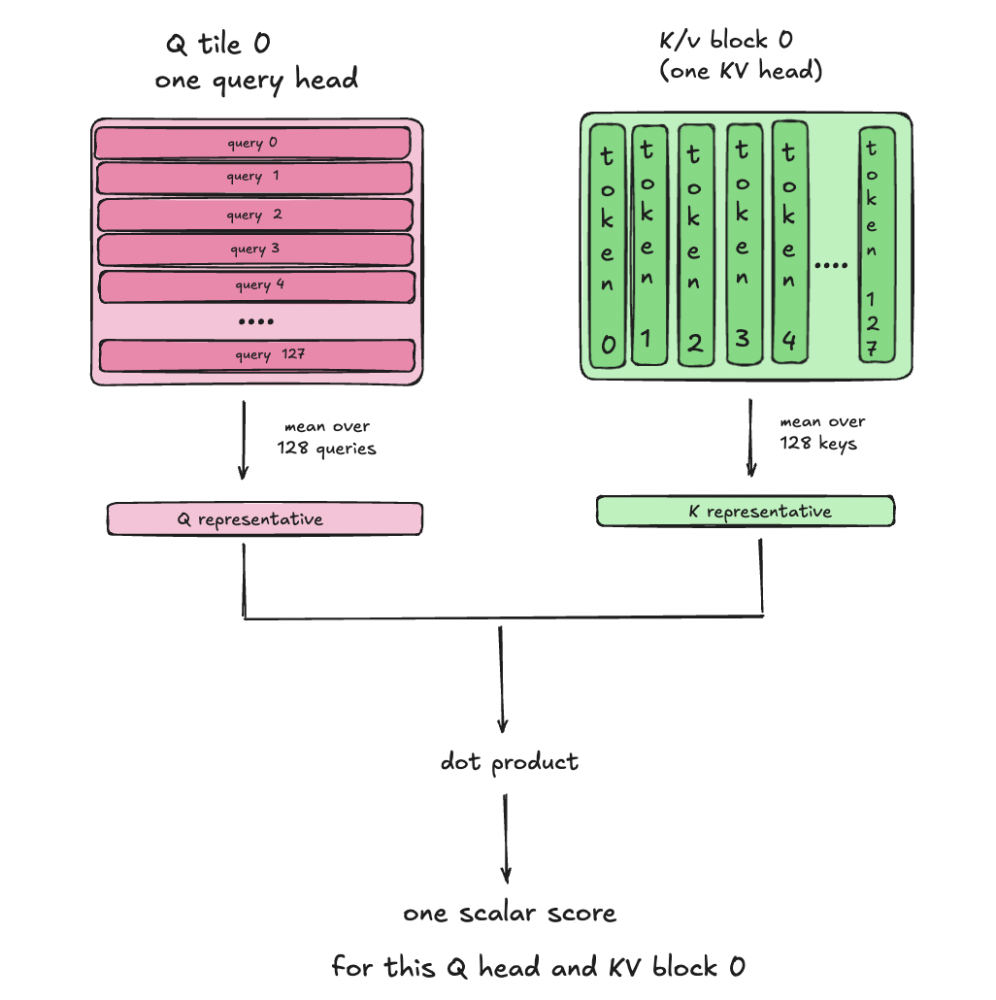

R1 is inexpensive, but there is one huge disadvantage: averaging 128 tokens into one vector can hide important differences inside the block. 

### R4: Four Representatives 

R4 keeps more information about the variation between different parts of a block. Instead of averaging all 128 tokens together, it divides the block into four consecutive groups of 32 tokens and computes one representative vector per group.

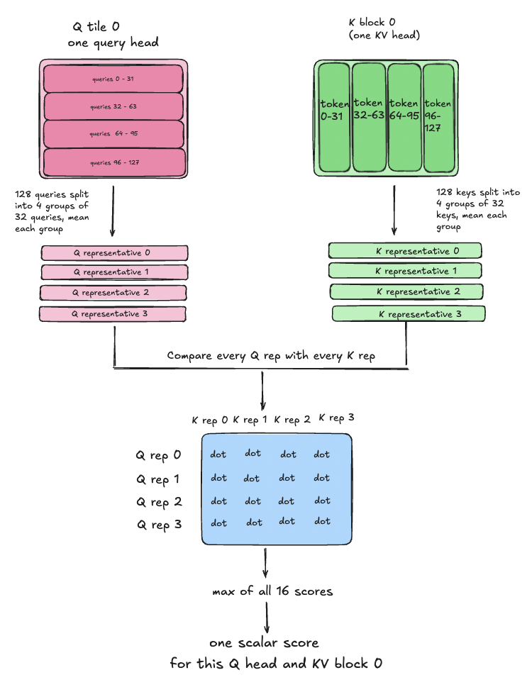

For one Q/K block pair, we now compare four query representatives with four key representatives: 16 comparisons per query head. The largest score across representative pairs and query heads becomes the block score. We again select TopK16.

R4 can preserve differences between parts of a block that R1’s single average would hide, but it costs more to build and compare the representatives.

### FP4: Token-Level Scoring, Block-Level Selection

The third type of indexer uses extra vectors called Qidx and Kidx to choose blocks (the actual attention still uses the original BF16 Q/K/V). I reused MiniMax’s NVFP4 scorer. It compares one Qidx vector with the 128 Kidx vectors inside a KV block and keeps the largest score. In MiniMax, each query chooses its own blocks. In my version, 128 queries share one selected list. FP4 simply means these comparisons use 4-bit inputs. The main attention still runs in BF16.

For each block, we take the largest score among those 128 queries. Then we pick the 16 blocks with the highest scores. The whole Q tile and its GQA group share this list.

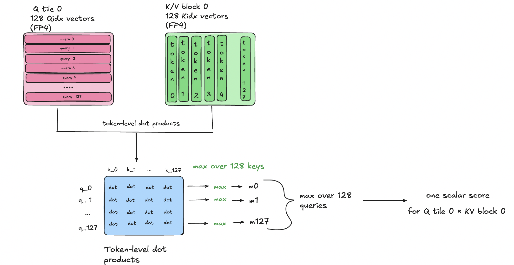

All tests use synthetic data. R1 and R4 choose blocks using the same Q/K tensors that attention processes. Our FP4 path uses separate random inputs, unrelated to those Q/K. This lets us measure its speed and integration with attention, but does not show whether it chooses useful blocks.

All three selectors return block IDs to the same attention kernel. A cheaper selector saves time, but may miss important blocks. A more detailed selector costs more, and that extra cost is only worthwhile if it helps choose better blocks.

The next step is therefore to measure cost of selection. These speed measurements do not prove that a real model would preserve its quality.

### Benchmarking the Selectors

Choosing blocks is not free. A selector may help us skip attention work, but it also adds work of its own.  For each selector, our kernel and FA4 sparse receive identical Q/K/V and selected block IDs.

The benchmark also runs on NVIDIA B200 with BF16 attention, batch size 2, 16 query heads sharing one KV head, and head dimension 128. Query length stays at 4,096 while KV length varies. Each Q128 tile selects 16 blocks of 128 tokens.

First, i measure the selectors on their own. At KV length 16K, using Gaussian synthetic inputs:

| Selector | Selection time, μs |
| :--- | ---: |
| R1 | 22.09 |
| R4 | 60.73 |
| FP4, prepared inputs* | 48.38 |

R1 and R4 timings include building the representatives, scoring blocks, and selecting TopK16. The FP4 path starts from prepared synthetic index vectors and scales. Their preparation and quantization are excluded, so its timing boundary differs from R1/R4. These numbers compare execution cost, not selection quality.

Next, i measure the complete selector and attention pipeline at the same K/V length
At K/V length 16K:

| Selector | Our pipeline, effective TFLOP/s | FA4 pipeline, effective TFLOP/s | Faster implementation |
| :--- | ---: | ---: | :--- |
| R1 | 889.6 | 787.9 | Ours, 1.13× |
| R4 | 734.8 | 650.0 | Ours, 1.13× |
| FP4* | 761.7 | 658.3 | Ours, 1.16× |

Effective TFLOP/s uses the same useful FLOPs as in Chapter 3, but divides them by the time of the whole selector → attention pipeline.

On these synthetic workloads, the pipeline using our kernel is approximately 1.12–1.16× faster across KV lengths 4K, 8K, and 16K. R1 gives the highest pipeline throughput at 8K and 16K, but this does not establish that it chooses the most useful blocks. FP4 uses prepared synthetic index vectors independent of the main Q/K; input preparation is excluded. Selection quality on a real model has not been evaluated.

Choosing blocks and processing them are two parts of the same problem. A more detailed selector costs more, and that extra work is only worth if it helps us keep more useful information. We now have a working selector sparse attention pipeline and measurements of its speed.

## Chapter 5 — What if every query keeps its own list?

In Chapter 4, I showed an FP4 selector that I mostly took from Minimax but with one change: in MiniMax, each query chooses its own blocks, while in my version, all 128 queries of a Q tile share one list. The reason was not the scorer but my kernel, in chapter 1 I mentioned two types of scheduling organization:  Q-centric and KV-centric. Until now i used Q centric organization. In this chapter I introduce you the other one, KV-centric. 

### Our Q-centric implementation: one list per Q tile

In my Q-centric kernel, one CTA takes loads one Q tile and walks through one list of KV blocks, so all queries in the tile must agree on that list. The output of the tile is finished inside the CTA.

The diagram shows one CTA:

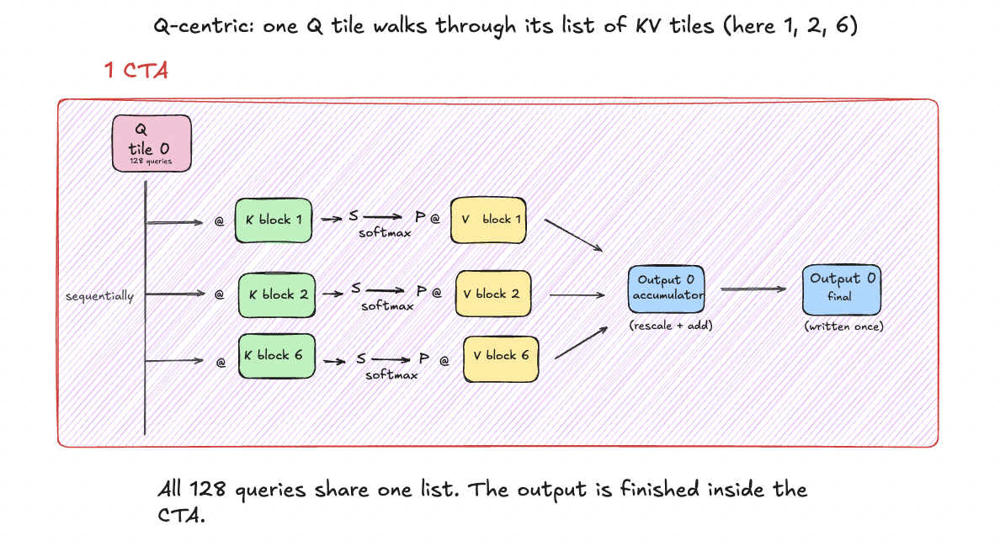

That is why my selectors in Chapter 4 choose blocks per Q tile. 

### KV-centric implementation

But if every query chooses its own blocks, the tile has to visit every block that at least one of its 128 queries selected. With independent lists, that is almost every block. For example, at 4K keys there are 32 blocks and each query selects 16. Each block is needed by only about 64 of the 128 queries, but the tile still has to visit it. The tile does the work of dense attention, and only part of it is useful.

The KV-centric organization avoids this. One CTA processes a K/V block for a chunk of queries that selected it. Popular blocks can be split across several CTA tasks.

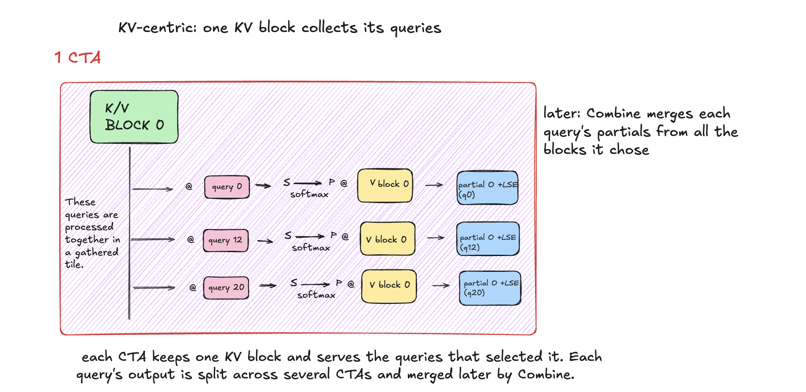 

The CTA works only on the queries that actually selected the KV block, so no math is spent on queries that didn't. This makes KV-centric useful when every query has its own list. It should pay off most on long sequences, where each block is needed by only a few queries of a tile. If neighboring queries choose similar blocks, Q-centric is the better choice, because it does not pay the costs described below.

### What changes in the architecture

The Q-centric pipeline is short: the selector gives lists, and the attention kernel produces the final output. KV-centric adds three new parts.

**1. Reverse index.**

The selector gives each query its list of blocks. The kernel needs the opposite: for each block, the queries that chose it. A small GPU step builds this before attention runs. It also remembers each block's place in each query's list, so the kernel knows where to write the result. Some blocks are chosen by many queries and some by few, so this step also splits the query list of a popular block into several tasks to keep the work balanced.

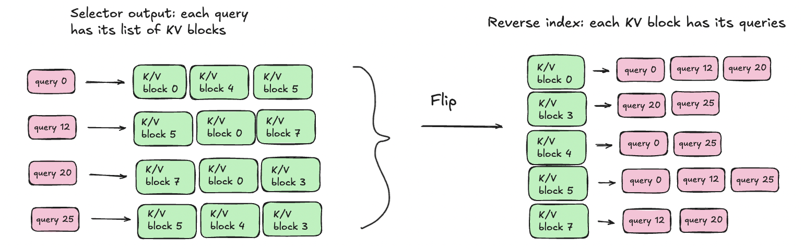

**2. Gathering Q.**

In Q-centric, the 128 queries of a tile are neighbors, so Q is loaded as one tile. In KV-centric, the queries of one tile can come from anywhere in the sequence, so they have to be collected first. And each query is loaded 16 times, once for every block it chose.

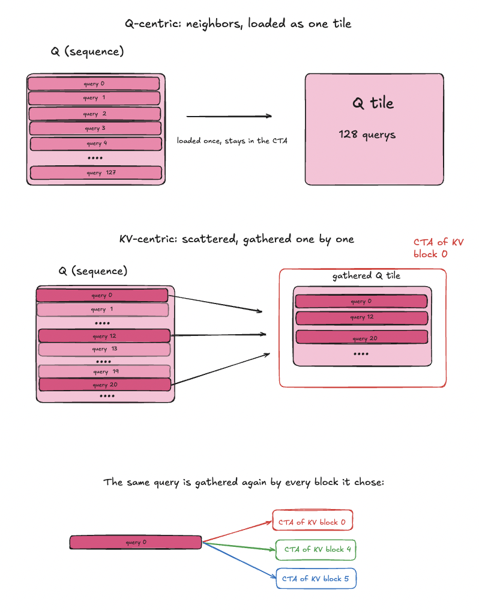

**3. Partial outputs and Combine.** 

This is the biggest change. In Q-centric, one CTA sees all the blocks of its tile, so the softmax finishes inside the kernel. In KV-centric, each CTA sees only one of the query's 16 blocks, so it can't produce the final output. Instead, it writes a partial result: a partial output and a log-sum-exp value (LSE) for each query and head. Combine uses the LSE values from all selected blocks to calculate their relative weights, then merges the partial outputs. It is not a simple average.

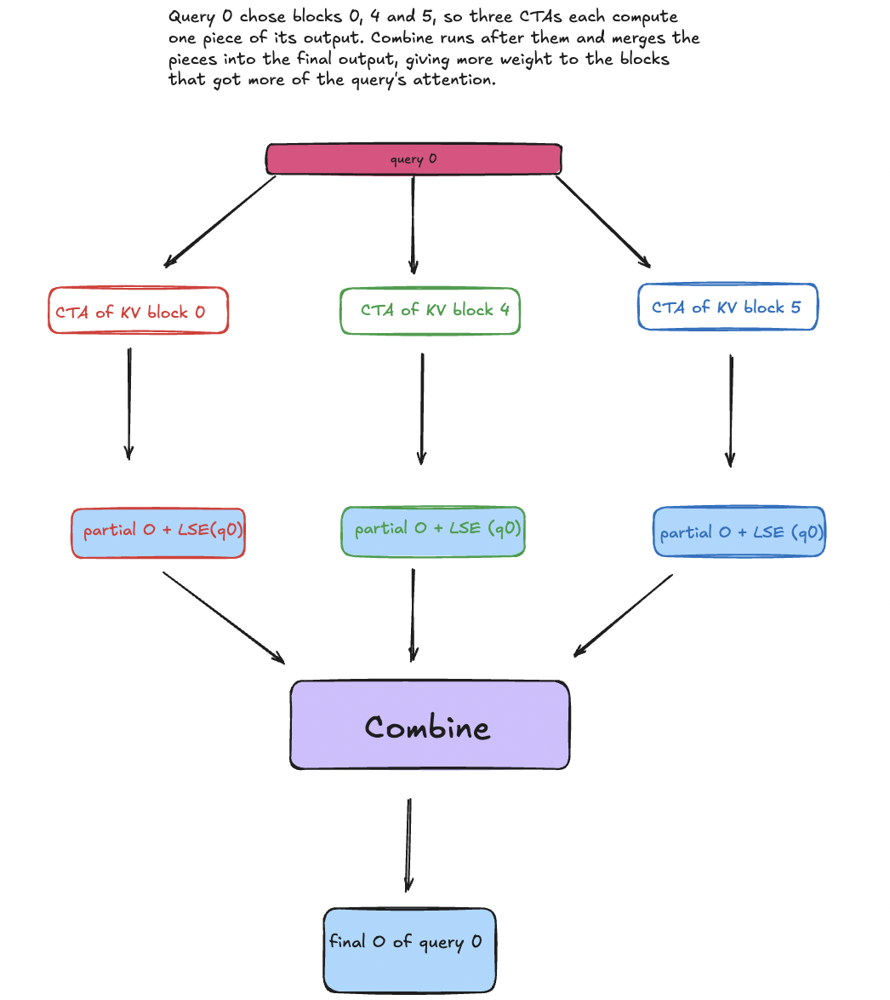

### The cost: moving data

KV-centric removes wasted math, but it adds data movement. The main cost is the partial outputs. Every query has 16 of them instead of one final output. With FP32 partials, they take 32 times more memory than the final BF16 output; with BF16 partials, 16 times. The attention kernel writes all of them, and Combine reads all of them back.

As in Chapters 2 and 3, I measured with given lists: each query gets 16 random blocks, chosen independently of other queries. The shape is batch 8, 16 query heads sharing one KV head, 4096 queries and 4096 keys, 16 of 32 blocks per query. The mask and shape differ from Chapters 2–4, so these times can't be compared with the Q-centric kernel.

Here is how the total time splits between the parts. Both columns use the same kernel; only the format of the partial outputs changes (100% = the whole operator: 2.28 ms with FP32 partials, 1.55 ms with BF16 partials):

| Part | FP32 partials | BF16 partials |
|---|---:|---:|
| Attention kernel | 70% | 76% |
| Combine | 28% | 22% |
| Reverse index and the rest | 2% | 2% |

Combine alone takes about a quarter of the time, and it does no attention math: it only reads partials and adds them up with these weights. The attention kernel pays too. In an earlier version of the kernel, I built a test variant that skipped all the math and only gathered Q and wrote partials. It still took 77% of the attention kernel's normal time. So in my KV-centric kernel, the time goes to moving data, not to matrix multiplications.  

### Q-centric vs KV-centric

| | Q-centric | KV-centric |
|---|---|---|
| Who has a list | a Q tile | each query |
| One CTA takes | a Q tile | a KV block |
| It loops over | selected KV blocks | queries that chose the block |
| Q rows | neighbors, loaded as one tile | scattered, gathered |
| Softmax finishes | inside the kernel | in Combine |
| Kernel writes | final O | 16 partial outputs per query, each with its LSE|
| Extra steps | none | reverse index, Combine |

Q-centric and KV-centric compute the same attention. They differ in who owns the loop. Q-centric is simple and efficient when the queries of a tile agree on their blocks. KV-centric keeps every query's own choice and avoids computing attention for queries that did not select the current block, but it pays by moving data: flipping the lists, gathering queries, and writing and merging partial outputs.

My KV-centric kernel is my own CUDA implementation of a known idea: the dataflow comes from the MiniMax MSA paper, but my kernel doesn't call MSA's code. It is forward-only and non-causal, and no per-query selector is connected yet, so this chapter says nothing about model quality.

## Conclusion

I started from a fast dense kernel and turned it into a block-sparse one. The loop change was small, but independent lists meant each Q tile needed its own K/V stream. With the same masks, my kernel was 1.14× faster than FA4 sparse on independent lists, and FA4 was 1.12× faster when neighboring tiles shared lists. Simple selectors added 22–61 µs at 16K keys, and the full pipeline stayed 1.12–1.16× faster. When every query keeps its own list, I turned the loop around (KV-centric): no wasted math, but the time goes to moving data.

What i take from this:

- Selecting the mask and scheduling it are separate problems.
- The structure of the mask, not just the number of blocks, decides which kernel wins.
- Selection is not free, and only a quality test can show if a richer selector is worth it.
- More freedom in the mask costs data movement.

Limits: B200 only, forward only, no causal masks, synthetic data, no model-quality results. Next: test selectors on real activations, connect a per-query selector to the KV-centric kernel, and measure it on long sequences.

## Stay in touch

More posts on ML systems and GPU kernels are coming. If you have questions or ideas about this post, I would be happy to hear from you.

Follow me: [X](https://x.com/Dinara2day) · [LinkedIn](https://www.linkedin.com/in/dinara2day/) · [GitHub](https://github.com/dinara-dl)

